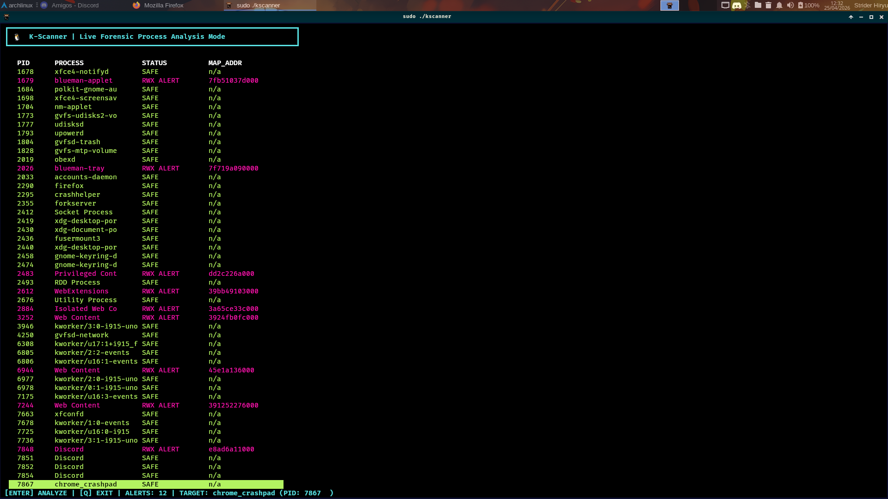
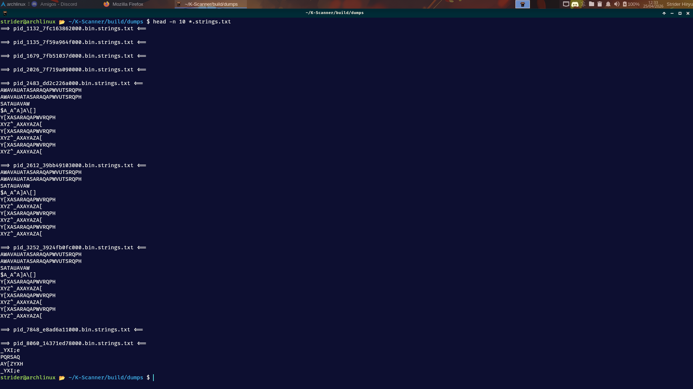
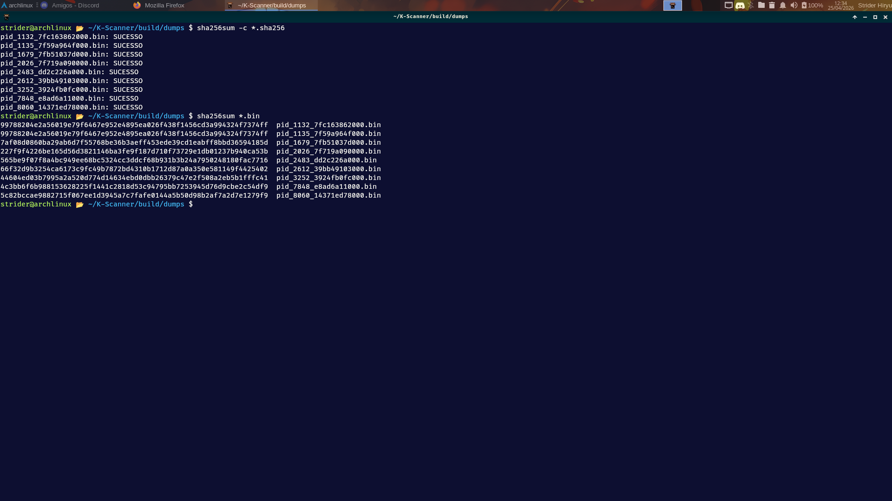

# K-Scanner

Lightweight Linux memory auditing tool focused on RWX (W^X) detection and
automated forensic triage.

[](https://github.com/jeffersoncesarantunes/K-Scanner/actions/workflows/ci.yml)
[](https://github.com/jeffersoncesarantunes/K-Scanner/actions/workflows/codeql.yml)
[](LICENSE)

## Overview

K-Scanner is a forensic utility that inspects active Linux processes for memory
regions violating the **W^X (Write XOR Execute)** security principle. Written in
pure **C99**, it pairs a high-performance scanning engine with an interactive
**ncurses TUI** so you can navigate processes, spot RWX regions, and extract
forensic evidence in real time.

Host memory inspection must run natively with the required privileges. A
container only sees its own PID and memory namespace unless given host-level
access, so no Docker image is provided.

Common RWX scenarios:

* Shellcode injection
* Reflective payload loading
* Fileless malware execution
* JIT-compiled engines (Firefox, Python, Node.js, Discord)

## Features

* Interactive ncurses TUI for live process inspection
* Real-time RWX memory detection via `/proc/[PID]/maps`
* One-key forensic extraction
* Automatic SHA256 integrity hashing
* Automatic strings and hexadecimal preview generation
* x86-64 disassembly (via `objdump`)
* Shellcode pattern detection (NOP sleds, syscalls, JMP gadgets, ROP, `/bin/sh`)
* SAFE / RWX ALERT classification
* Confidence-based alert levels (LOW / MEDIUM / CRITICAL)
* JIT engine detection (V8, SpiderMonkey, LuaJIT, Mono, .NET, JVM, Dart)
* `--silent-jit` flag to suppress JIT false positives
* `--watch` headless continuous monitoring (2-second cycles)
* JSON / CSV export
* Live regex memory hunting (`--live <PID> <pattern>`)
* eBPF real-time RWX telemetry (`--bpf`, requires root + libbpf)
* eBPF syscall coverage: `mmap`, `mprotect`, `shmat` (`SHM_EXEC`), `execve`
* YARA rule-based scanning (`--yara <rule.yara>`)
* Container-aware detection (Docker, Kubernetes, LXC via cgroup)
* PKGBUILD available for AUR

## Quick Start

```bash
git clone https://github.com/jeffersoncesarantunes/K-Scanner.git
cd K-Scanner && make bpf && make
sudo ./kscanner
```

## Build

```bash
make bpf && make              # Build BPF object + main binary
make clean && make bpf && make  # Clean rebuild
make test                     # Run automated tests
```

## Deploy

```bash
sudo make install     # Install system-wide (binary + BPF object)
sudo make uninstall   # Uninstall
```

## Usage

### General

```bash
./kscanner --help                  # Help
sudo ./kscanner                    # Standard execution (TUI)
sudo ./kscanner --silent-jit       # Suppress JIT false positives
sudo ./kscanner --bpf              # eBPF real-time RWX monitoring
sudo ./kscanner --watch            # Continuous headless monitoring
```

### Export

```bash
sudo ./kscanner --json        # JSON export (headless)
sudo ./kscanner --csv         # CSV export (headless)
sudo ./kscanner --watch --json  # Continuous monitoring in JSON-Lines format
```

### Advanced

```bash
sudo ./kscanner --live <PID> '<regex>'          # Live regex memory hunting
sudo ./kscanner --yara /path/to/rules.yara      # YARA rule scanning
sudo ./kscanner --bpf --silent-jit --yara myrules.yara  # Combine all flags
```

### Example Output

```text
 PID    PROCESS              STATUS       CONFIDENCE  MAP_ADDR
 1132   python3              RWX ALERT    LOW         7fc163862000
 1135   fail2ban-server      RWX ALERT    CRITICAL    7f59a964f000
 1426   Xorg                 SAFE         SAFE        n/a

 [ENTER] ANALYZE | [Q] EXIT | ALERTS: 12 | BPF: OFF
```

Not every RWX region is malicious — context matters. Browsers, Python, Node.js,
and Electron apps may allocate RWX memory for JIT compilation. Anonymous
executable pages or RWX regions in non-JIT processes warrant forensic priority.

## Investigation & Post-Analysis Workflow

Once an RWX region is spotted, press `ENTER` in the TUI. K-Scanner
automatically:

1. Dumps the RWX region
2. Generates a SHA256 checksum
3. Extracts printable strings
4. Produces a hexadecimal preview

```bash
cd build/dumps
sha256sum -c *.sha256
grep -iE "http|ssh|cmd|bash|token|pass" *.strings.txt
head -n 20 *.hex.txt
```

Each memory extraction produces:

* Raw binary dump (`.bin`)
* SHA256 checksum (`.sha256`)
* Extracted strings (`.strings.txt`)
* Hexadecimal preview (`.hex.txt`)
* x86-64 disassembly listing (`.disasm.txt`)
* Shellcode pattern analysis (`.shellcode.txt`)
* YARA rule matches (`.yara.txt`, when `--yara` is active)

## Project in Action







## Operational Integrity

* Passive / read-only analysis
* No process injection
* Controlled memory dumping
* Automatic evidence integrity validation

## Deployment

### Requirements

* Linux Kernel 5.x or newer
* `gcc`, `make`
* `ncurses`, `binutils`, `coreutils`
* `yara` (optional, required for `--yara`)
* UTF-8 compatible terminal
* Root privileges

### Optional (eBPF telemetry)

* `libbpf` (runtime + build-time)
* Clang (build-time, for BPF compilation)
* Kernel BTF (`/sys/kernel/btf/vmlinux`)
* `CONFIG_BPF`, `CONFIG_BPF_SYSCALL`, `CONFIG_DEBUG_INFO_BTF` enabled

## Repository Structure

```text
├── bin/
│   └── kscanner
├── build/
│   ├── bpf/
│   ├── dumps/
│   └── obj/
├── docs/
│   ├── architecture.md
│   ├── forensic_methodology.md
│   ├── performance_and_limitations.md
│   ├── threat_model.md
│   └── use_cases.md
├── examples/
│   └── usage.md
├── Images/
│   ├── kscanner1.png
│   ├── kscanner2.png
│   └── kscanner3.png
├── include/
├── scripts/
│   ├── build.sh
│   ├── diagnostic.sh
│   ├── forensic_triage.sh
│   ├── run_tests.sh
│   └── setup_dev_env.sh
├── src/
│   ├── bpf/
│   ├── core/
│   └── modules/
├── tests/
│   ├── cases.md
│   └── unit/
├── .clang-format
├── .github/
│   ├── ISSUE_TEMPLATE/
│   ├── workflows/
│   └── PULL_REQUEST_TEMPLATE.md
├── .gitignore
├── .pre-commit-config.yaml
├── CHANGELOG.md
├── CODE_OF_CONDUCT.md
├── CONTRIBUTING.md
├── LICENSE
├── Makefile
├── PKGBUILD
├── SECURITY.md
└── README.md
```

## Tech Stack

* **Language:** C99
* **Interface:** ncurses
* **Data Source:** `/proc`, `raw_tp/sys_enter` (eBPF)
* **Telemetry:** eBPF + libbpf (optional, requires kernel BTF)
* **Hashing:** SHA256
* **Build Tool:** GNU Make + Clang (for BPF)
* **Target:** Linux Kernel 5.x / 6.x

## Documentation

* [Architecture](./docs/architecture.md)
* [Forensic Methodology](./docs/forensic_methodology.md)
* [Threat Model](./docs/threat_model.md)
* [Performance & Limitations](./docs/performance_and_limitations.md)
* [Use Cases](./docs/use_cases.md)

## Security

See [SECURITY.md](./SECURITY.md) for the disclosure policy. Do not open public
issues for security vulnerabilities.

## Contributing

See [CONTRIBUTING.md](./CONTRIBUTING.md) for guidelines on reporting issues and
submitting pull requests.

## License

[MIT](LICENSE)
